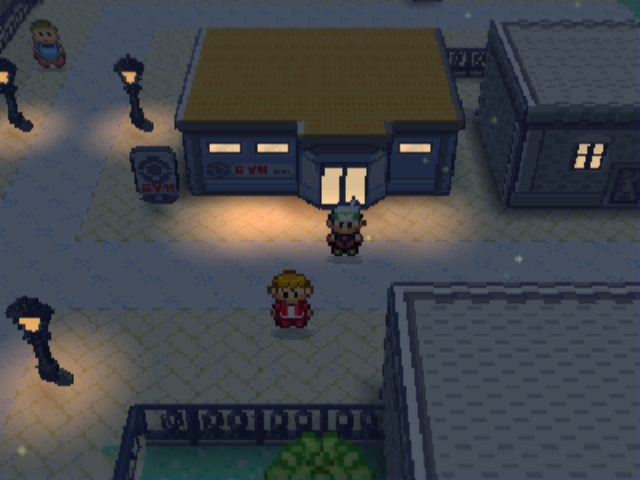
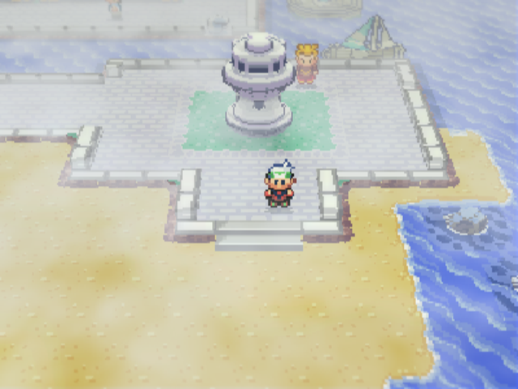
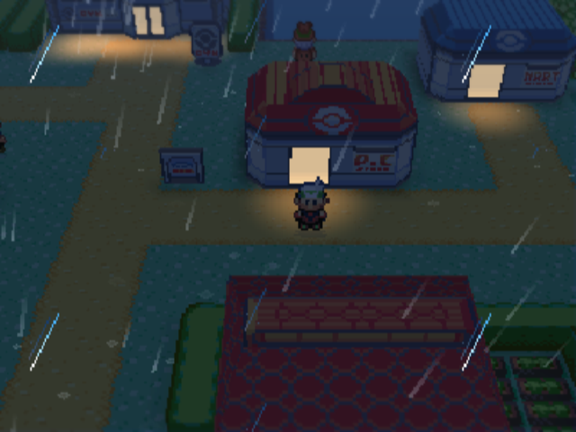
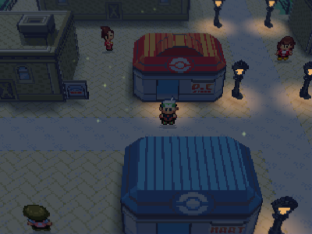
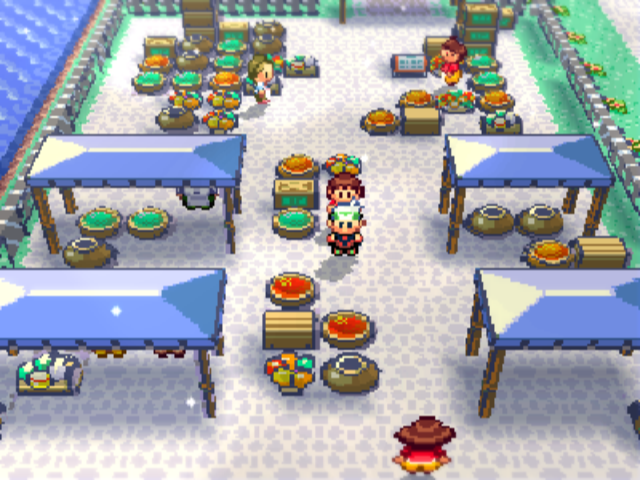
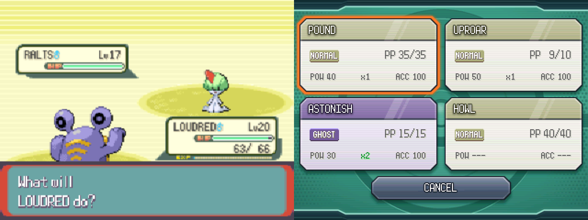
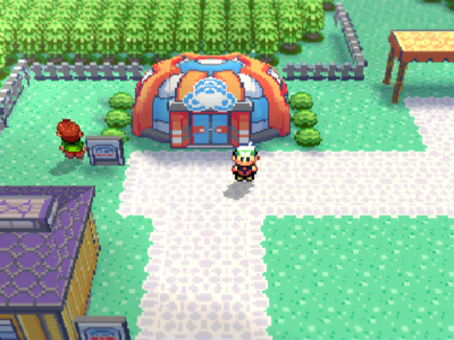

<h1 align="center">Pokémon Emerald RG3DS</h1>

<p align="center">
  <strong>Pokémon Emerald 3Ds Dual Screen, tuned for the Anbernic RG DS.</strong><br>
  A fork of <a href="https://github.com/ZallaxDev/pokeemerald-3Ds-dualscreen">ZallaxDev's Pokémon Emerald 3Ds Dual Screen</a> by <a href="https://github.com/Rubbed-Genie">Rubbed-Genie</a>.
</p>

<p align="center">
  
</p>

The RG DS is a dual-screen handheld with two **4:3, 640×480** panels. It runs 3DS software through the Azahar
emulator on ROCKNIX. The original port is laid out for the 3DS's wide 400×240 top screen, so on the RG DS it was
stretched or letterboxed and the menus were small. RG3DS lays it out for the RG DS's screens, then adds its own nights,
weather, battle layout and models.

This branch, `rg3ds-dev`, is RG3DS on ZallaxDev's `dev` branch, where upstream does its work. The port, the touch
interface, the voxel overworld, followers and the day/night cycle are all ZallaxDev's work and their contributors'.
RG3DS is a layer on top.

<table>
  <tr>
    <td></td>
    <td></td>
  </tr>
  <tr>
    <td align="center"><em>Morning sea fog at Slateport's lighthouse</em></td>
    <td align="center"><em>Rain falling in 3D over Petalburg</em></td>
  </tr>
  <tr>
    <td></td>
    <td></td>
  </tr>
  <tr>
    <td align="center"><em>Rustboro at night</em></td>
    <td align="center"><em>Slateport's market, its goods as models</em></td>
  </tr>
</table>

### What's different

**Made for the RG DS's screens** (built with `TOP_WIDTH=320`)
- The top screen is laid out at **4:3 (320×240)** and shown at an exact 2× on the 640×480 panel, so pixels stay sharp
  and nothing is stretched.
- Bigger title, naming, map, PC, mart, bag, party, summary and battle-text screens.
- A lower, longer-lens indoor camera chosen by playing through the early game (tilt 33°, zoom 155%), with people a
  little forward on their tile at 93% size so they stand on it, and the mart clerk lifted above the glass counter.
- Every value is a built-in default (`sEditionDefaults` in [`3ds_port/src/3ds_settings.c`](3ds_port/src/3ds_settings.c))
  that `settings.txt` can override, or `tune.txt` live while the game runs (with `dev_files=1`).

**Night** (OPTIONS > ENHANCEMENTS > DAY/NIGHT on)
- Darker nights (`night_dark`: 45% of the light is kept at full night). The world, the sprites and the 2D layers all
  darken together.
- Every town building's windows glow. Authored windows carry over to buildings drawn the same way, and other glass is
  found by its colour.
- Warm light pools on the ground in front of the low windows and glass doors of gyms, marts, Pokémon Centers and small
  houses, each drawn as one smooth disc like the street lamps' pools.
- Light from overhead at night: short shadows round every base instead of the evening's long ones, a deeper contact
  shade, and a few fireflies on clear nights.

**Weather** (OPTIONS > ENHANCEMENTS > CHANGE WEATHER)
- Towns and routes with fair weather now sometimes get weather that suits the place: sea fog on a coast's mornings,
  showers inland, storms in the rainforest (patch 0057).
- Rain falls in 3D: streaks under the sky, splashes on the ground, and lightning flashes in a storm. Rain and fog cast
  no sun shadows.

<p align="center">
  
</p>

**Battles**
- The GBA's own battle boxes and text box (`battle_hd=0`, the 4:3 build's default; `battle_hd=1` for dev's HD
  interface). The scene sits above the zoomed text box, zoomed by 4/3 so all four boxes of a double battle fit on the
  screen, and every Pokémon stands on its own platform where the GBA puts it.
- Each move button on the bottom screen shows how effective the move is against the foe(s).

**Around the world**
- The field's text box is centred and 3 px over the screen's bottom edge (`box_margin`), with no line under it.
- People sit in seats (the chair hides their legs) instead of standing on them.

<p align="center">
  
</p>

**Models** (picked over dev's own): the Battle Tent dome (all three tents, each in its own town's art), Slateport
market's stalls and awnings (with back legs) and Stern's shipyard. Also models dev does not have: Lavaridge's and
Fortree's gyms in their own towns' art, Slateport's kerbs and beach breakwater, and the market's goods as props.
Every one passes `gen_voxel_buildings.py --verify` (the drawing is reproduced pixel for pixel).

**Dev menu** (ZL+ZR): time of day, day/night, night light, weather held across maps, and warps to Slateport,
Rustboro, Dewford, Petalburg or Mauville. Its settings last for that play only; nothing is saved.

### Building it

There is no download of the finished game: the `.3dsx` contains Pokémon Emerald's graphics, maps and music, which
belong to Nintendo, so you build it yourself. You need **git**, **Python 3.11+** with Pillow, and **Podman** (or
Docker).

```sh
git clone -b rg3ds-dev https://github.com/Rubbed-Genie/pokeemerald-RG3DS.git
cd pokeemerald-RG3DS
python3 tools/bootstrap.py                     # pinned pret/pokeemerald + patches -> build/upstream
python3 build/upstream/builder/emerald3ds_builder/followers.py --out build/upstream/3ds_port/romfs   # optional: followers
cd build/upstream
podman run --rm -v "$PWD":/work:Z -w /work docker.io/devkitpro/devkitarm sh -c '
  apt-get update -qq && apt-get install -y -qq libpng-dev python3-pil &&
  make tools && make generated PYTHON=python3 &&
  make -C 3ds_port -j8 PYTHON=python3 TOP_WIDTH=320 DATA_BACKEND=1 EMBED_DATA=1'
```

The tools must be built inside the container (`libpng-dev`, `python3-pil`). Without Pillow the building models are
not regenerated and the link fails, sometimes without an error, so check the date of `3ds_port/emerald3ds.3dsx`.
`TOP_WIDTH=320` gives the RG DS layout; leave it out for the 3DS's own 400-wide layout. `EMBED_DATA=1` puts the game
data inside the `.3dsx` (about 40 MB), so it needs no separate data pack.

### Installing on the RG DS (ROCKNIX)

1. Copy `build/upstream/3ds_port/emerald3ds.3dsx` to `roms/3ds/` (rename it as you like) and launch it from the 3DS
   system (Azahar).
2. For sound, put a `dspfirm.cdc` dumped from your own 3DS in `roms/3ds/azahar/sdmc/3ds/`.
3. Install the launcher hook [`rocknix/054-azahar-3dsx-stretch`](rocknix/054-azahar-3dsx-stretch) in
   `/storage/.config/autostart/`. It turns on Azahar's top-screen stretch for `.3dsx` homebrew only (retail 3DS games
   stay 5:3), keeps Azahar fullscreen, and moves Azahar's bottom-screen window onto the bottom panel. Without that last
   step the game stalls on a black screen.
4. Optional: in ROCKNIX, set the game's Azahar resolution to 2× for a sharper 3D world.

Saves and settings live in `roms/3ds/azahar/sdmc/3ds/emerald3ds/`, the same place as the original port's.

### Credits

- **[ZallaxDev](https://github.com/ZallaxDev)** and the port's contributors: Pokémon Emerald 3Ds Dual Screen, which
  this is built on. Support the original: [Ko-fi](https://ko-fi.com/zallax),
  [Discord](https://discord.com/invite/tfqHF8496P), [emerald-3ds.com](https://emerald-3ds.com/).
- **[pret](https://github.com/pret/pokeemerald)**: the Pokémon Emerald decompilation.
- **[gradenGnostic/pokeemerald-multiplatform](https://github.com/gradenGnostic/pokeemerald-multiplatform)**: the
  original voxel renderer.
- **[Rubbed-Genie](https://github.com/Rubbed-Genie)**: RG3DS, playtested on an Anbernic RG DS.

---

<details>
<summary><strong>The original Pokémon Emerald 3Ds Dual Screen README</strong> (for the 3DS release, web builder and full documentation)</summary>

<p align="center">
  
</p>

<h1 align="center">Emerald 3DS</h1>

<p align="center">
  <strong>Rediscover Hoenn. Two screens. A new perspective.</strong><br>
  A native Nintendo 3DS port with a touch interface and an optional voxel overworld.
</p>

<p align="center">
  <a href="https://emerald-3ds.com/"></a>
  <a href="https://x.com/DustZallax"></a>
  <a href="https://discord.com/invite/tfqHF8496P"></a>
  <a href="https://ko-fi.com/zallax"></a>
</p>

## Get the latest version — directly in your browser

**Visit [emerald-3ds.com](https://emerald-3ds.com/) to generate and download the latest version from your own supported ROM. No desktop builder or source code download is required.**

The website includes the **complete installation and update instructions**, **sound setup** and **frequently asked questions**. Start there whether you are installing for the first time, updating or troubleshooting.

> **Need help? Please read the instructions and FAQ on [emerald-3ds.com](https://emerald-3ds.com/) before opening an issue or asking on Discord.** If your question is still unanswered, include your console or emulator, game version and the exact error message when asking for help.

<p align="center">
  <a href="#screenshots">Screenshots</a> &nbsp; · &nbsp;
  <a href="#features">Features</a> &nbsp; · &nbsp;
  <a href="https://emerald-3ds.com/">Web builder, instructions &amp; FAQ</a> &nbsp; · &nbsp;
  <a href="#documentation">Documentation</a> &nbsp; · &nbsp;
  <a href="#community">Community</a> &nbsp; · &nbsp;
  <a href="#support-the-project">Support the project</a>
</p>

---

Emerald 3DS brings the adventure to Nintendo 3DS as
**native homebrew**. The game runs on the top screen, while a dedicated touch
interface on the bottom screen replaces the START menu. Enable the optional
**voxel overworld** to explore supported areas from a new angle.

## Screenshots

<p align="center"><em>A look at the adventure across both screens.</em></p>

<table>
  <tr>
    <td></td>
    <td></td>
  </tr>
  <tr>
    <td></td>
    <td></td>
  </tr>
</table>

<details>
<summary><strong>View more screenshots · 9 more images</strong></summary>

<br>

<table>
  <tr>
    <td></td>
    <td></td>
  </tr>
  <tr>
    <td></td>
    <td></td>
  </tr>
  <tr>
    <td></td>
    <td></td>
  </tr>
  <tr>
    <td></td>
    <td></td>
  </tr>
 
</table>

</details>

## Features

| | What to expect |
| :--- | :--- |
| **Native 3DS homebrew** | Runs directly on the console's ARM11 using libctru, Citro2D and Citro3D, without an emulator. |
| **Two screens, one adventure** | The game on top, with a dedicated touch interface below in place of the START menu. |
| **Four languages** | English, Spanish, French and Italian, each built from your own cartridge of that language: texts, graphics and credits come from your ROM. |
| **Optional voxel overworld** | Modelled buildings, trees, signposts and terrain relief, with adjustable camera angle and zoom, and real stereoscopic 3D on a New 3DS. |
| **HD battle interface** | Info boxes and text box drawn at the top screen's full resolution; optional 3D battles over the voxel world. |
| **Follower Pokémon** | Optional: your lead Pokémon walks behind you with its HeartGold/SoulSilver overworld sprite and answers when you talk to it. |
| **Optional day/night lighting** | Morning, daylight, sunset and night outdoors in 2D and voxel mode, lit windows and street lamps, and a clock that can run up to 120X. |
| **Local wireless play** *(experimental)* | Union Room, trades, battles, Berry Blender, minigames and link contests between 3DS systems nearby. |
| **Enhancements** | All optional: physical/special split, IVs and EVs on the summary, infinite TMs, running indoors, Repel prompt, visible wild Pokémon, faster speeds and more. |
| **Built from your own cartridge** | The builder generates the game data locally from your own dump. No ROM content is distributed. |

### A new perspective on Hoenn

The voxel overworld is **off by default**. Open **OPTION** on the bottom
screen and enable **VOXEL 3D**, then adjust **3D ANGLE** and **3D ZOOM** to
set your camera. On a New 3DS, raise the 3D slider for a stereoscopic world;
**3D WORLD** and **3D DEPTH** (OPTION → SETTINGS, second page) control it.

> **3D mode is a work in progress.** Many towns and routes now have modelled
> buildings and relief, but large parts of the map and most interiors are
> still shown flat, and the Battle Frontier is only an early start. More
> areas will be modelled as the project moves forward.

### Day and night

In **OPTION → ENHANCEMENTS**, set **DAY / NIGHT** to **AUTO** to enable
outdoor lighting inspired by HeartGold/SoulSilver. It is **OFF by default**;
indoors, caves, underwater areas, menus and classic battles keep their
original colours. Nights have a soft moonlit blue, and supported voxel
windows and street lamps glow warm.

**CLOCK SPEED** selects **1X, 6X, 12X, 24X, 60X or 120X**. At 1X, lighting
follows Emerald's own clock; higher speeds advance a separate clock (60X is
a day in 24 real minutes) and berries grow with it. Daily events and the
GBA save format stay original, and time with the console asleep or off runs
at 1X. Back up `emerald3ds.clock` and `emerald3ds.clock.bak` together with
`emerald3ds.sav`.

**WILD POKEMON → TIMED** changes some grass encounters by morning, day and
night on routes 101–104, 110, 116–117, 119–121 and 123 (**ORIGINAL**, the
default, keeps the original tables). **SHOW CLOCK → ON** adds the time to the
bottom screen's map. More in the [day/night guide](docs/DAY_NIGHT.md).

### Follower Pokémon and local wireless

**OPTION → ENHANCEMENTS → FOLLOWER** makes your lead Pokémon walk behind you.
Its sprites and messages come from HeartGold/SoulSilver: the builder
downloads them while it builds (the only step that needs an Internet
connection; without one, the game is built without them).

**Local wireless play is experimental**: two to four consoles with the same
version and language can meet in the Union Room and use the link features of
Pokémon Centers, the Berry Blender, contests and the Battle Tower. Expect
bugs, and back up your save before trying it.

## Getting started

### Recommended: use the website

1. Open **[emerald-3ds.com](https://emerald-3ds.com/)** and follow the instructions for your console or emulator.
2. Select your **own clean, supported Pokémon Emerald ROM** in the web builder (see [supported cartridges](#supported-cartridges)).
3. Generate and download the game files, then follow the website's installation guide to place them correctly.
4. Complete the **sound setup** described in the guide before launching the game.

**Everything is generated in your browser. You do not need to download or install the Windows builder, Python or this repository.** You only download the resulting game files. Your ROM is processed locally in your browser and is not uploaded.

For a physical console, you need a **Nintendo 3DS / 2DS family console with custom firmware** and access to its SD card. Follow the website's instructions for the available launch methods.

### Supported cartridges

The game is built in the language of the cartridge you dump. Only clean,
unmodified dumps are accepted:

| Language | Cartridge | Game code |
| :--- | :--- | :--- |
| English | Pokémon Emerald Version (USA, Europe) | BPEE |
| Spanish | Pokémon Edición Esmeralda (Spain) | BPES |
| French | Pokémon Version Émeraude (France) | BPEF |
| Italian | Pokémon Versione Smeraldo (Italy) | BPEI |

Other languages (German, Japanese) and ROM hacks are not supported.

### Updating or having trouble?

**Use the [website's update instructions and FAQ](https://emerald-3ds.com/) as your first stop.** Follow the steps for the version you are installing, including regenerating the data pack when required.

- **No sound?** Follow the sound setup instructions; the required DSP firmware file is separate from the generated game files.
- **Using an emulator?** Follow the emulator instructions and use its emulated SD card location.
- **Missing or incompatible data pack?** Check the installation and update instructions and make sure your files match the release.
- **Still stuck?** Check the FAQ before asking for help on Discord or opening an issue.

<details>
<summary><strong>Alternative: desktop builder (Windows, Linux and macOS)</strong></summary>

### Windows

1. Download `Emerald3DS-vX.Y.Z-Windows.zip` from the [latest GitHub release](https://github.com/ZallaxDev/pokeemerald-3Ds-dualscreen/releases/latest) and extract the whole ZIP.
2. Run `Emerald3DS-Builder.exe`, choose your supported ROM and your SD card, then press **Install**.
3. Follow the [installation guide](docs/INSTALLATION.md), including sound setup, and launch the game from the Homebrew Launcher.

The builder writes `/3ds/emerald3ds/Emerald3DS.3dsx`, `Emerald3DS.smdh` and `emerald3ds.pak`. Your ROM is only read, not copied, uploaded or modified. The desktop builder needs an Internet connection only to download the optional follower sprites.

When an existing save is present, each desktop-builder install creates a new backup of it and any available clock/tracker companions in `SD:/3ds/emerald3ds/backup/<YYYYMMDD-HHMMSS>[-N]/`. Backups accumulate and are never pruned automatically. You can remove older backup folders manually when no longer needed; keep a recent complete backup. See the [builder documentation](builder/) for the backed-up files and incomplete `.partial` folders.

### Linux and macOS

Run the builder from source with **Python 3.11+ and Pillow**, using the `payload/` folder from the matching release ZIP:

```sh
python -m emerald3ds_builder --payload /path/to/payload install --rom /path/to/rom.gba --sd /path/to/card
```

See the [builder documentation](builder/) for setup and additional commands, and the [installation guide](docs/INSTALLATION.md) for updates.

</details>

## About this repository

**This repository contains no game content.** It holds the port's own code,
the tools that build it and the builder that turns *your own* cartridge dump
into the game's data pack. Nothing derived from the ROM is distributed here or
in the releases.

| Component | Location | Role |
| :--- | :--- | :--- |
| Engine | [pret/pokeemerald](https://github.com/pret/pokeemerald) · [`upstream.lock`](upstream.lock) | The Pokémon Emerald decompilation, pinned to a specific revision. |
| Port patches | [`patches/pokeemerald/`](patches/pokeemerald) | The port's changes to the upstream engine. |
| 3DS backend | [`3ds_port/`](3ds_port) | ARM11 backend, GPU compositor, NDSP audio, touch UI and voxel overworld. |
| Data builder | [`builder/`](builder/) | Creates the data pack locally from the player's own supported ROM. |

## Building from source

```sh
python tools/bootstrap.py        # pinned upstream + patches + port -> build/upstream
python tools/bootstrap.py --make # also builds the 3DSX there
python tools/bootstrap.py --make --spanish-rom esmeralda.gba  # Spanish build
python tools/bootstrap.py --make --french-rom emeraude.gba    # French build
python tools/bootstrap.py --make --italian-rom smeraldo.gba   # Italian build
```

The Spanish, French and Italian builds take their texts and graphics from your own
clean Spanish (BPES), French (BPEF) or Italian (BPEI) ROM; see
[Pokémon Esmeralda en español](docs/SPANISH.md),
[Pokémon Émeraude en français](docs/FRENCH.md) and
[Pokémon Smeraldo in italiano](docs/ITALIAN.md).

Start with the [development guide](docs/DEVELOPMENT.md) for requirements,
the development loop, loose data, data packs and host tests.

## Documentation

**For players: [emerald-3ds.com](https://emerald-3ds.com/) brings together the web builder, complete instructions and FAQ.** The repository guides below provide additional reference and development documentation.

| Guide | What's inside |
| :--- | :--- |
| [Install and update](docs/INSTALLATION.md) | Installation, sound setup and updating an existing installation. |
| [Development](docs/DEVELOPMENT.md) | Build requirements, workflow and tests. |
| [Spanish build](docs/SPANISH.md) | Playing in Spanish with your own Pokémon Esmeralda (Spain) ROM. |
| [French build](docs/FRENCH.md) | Playing in French with your own Pokémon Émeraude (France) ROM. |
| [Italian build](docs/ITALIAN.md) | Playing in Italian with your own Pokémon Versione Smeraldo (Italy) ROM. |
| [Architecture](docs/ARCHITECTURE.md) | How the engine and the 3DS backend fit together. |
| [Asset pipeline](docs/ASSET_PIPELINE.md) | How game data is prepared for the port. |
| [Releasing](docs/RELEASING.md) | Building and packaging a release. |
| [Contributing](CONTRIBUTING.md) | Guidelines for contributing to the project. |
| [Changelog](CHANGELOG.md) | Changes across releases. |

## Community

Before asking for installation or update help, please check the **[website instructions and FAQ](https://emerald-3ds.com/)**.

Join the **[Discord community](https://discord.com/invite/tfqHF8496P)** to
talk about the project and share your adventures in Hoenn. Follow
**[@DustZallax on X](https://x.com/DustZallax)** for project updates and
to stay in touch.

<p align="center">
  <a href="https://discord.com/invite/tfqHF8496P"></a>
</p>

## Support the project

If you're enjoying this new way to explore Hoenn, you can **buy me a coffee**
on Ko-fi. It's an optional way to support my work on the project, and every
coffee is appreciated. Thank you for being part of the adventure!

<p align="center">
  <a href="https://ko-fi.com/zallax"></a>
</p>

You can also support the project by starring the repository, sharing it
or [contributing](CONTRIBUTING.md).

---

## Provenance and licences

Only original Emerald 3DS code, tools and documentation are licensed by this
project ([LICENSE-PORT.md](LICENSE-PORT.md)). The decompilation, the game and
third-party components keep their own terms; see [NOTICE.md](NOTICE.md) and
[docs/PROVENANCE.md](docs/PROVENANCE.md). AI-assisted tooling was used during
development: [AI_DISCLOSURE.md](AI_DISCLOSURE.md).

Emerald 3DS is an unofficial fan project, not affiliated with or endorsed by
Nintendo, Game Freak, Creatures or The Pokémon Company. Pokémon and Pokémon
Emerald are trademarks of their respective owners.

</details>
